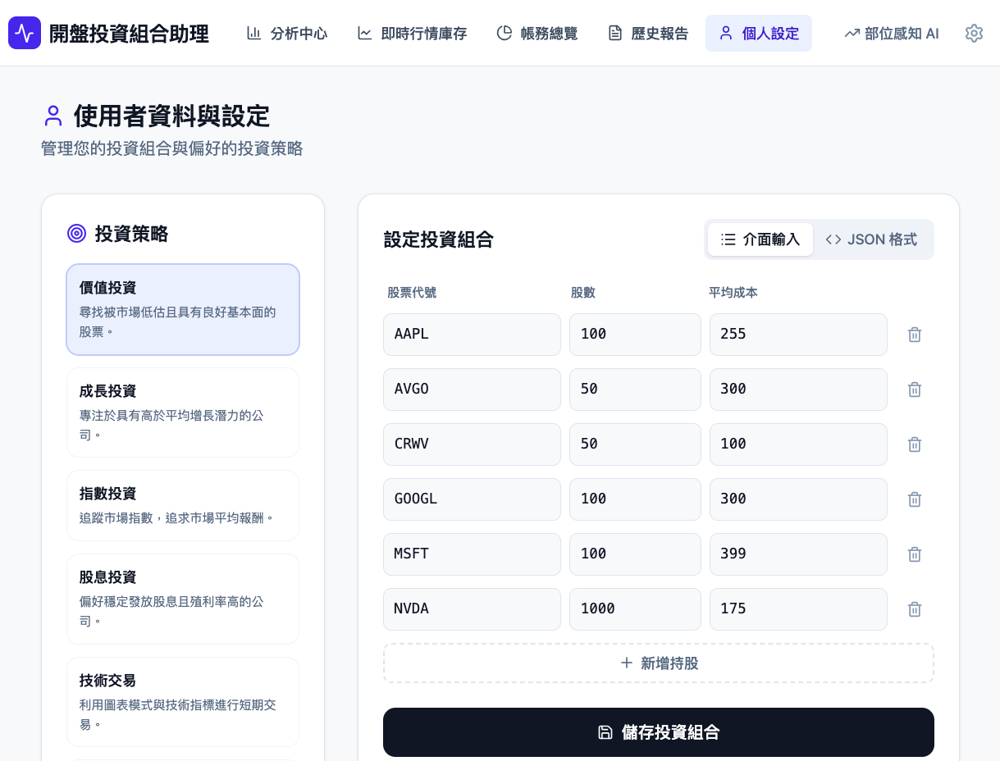
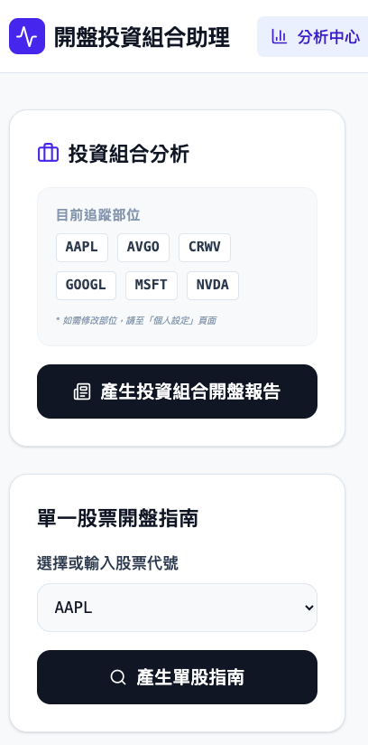
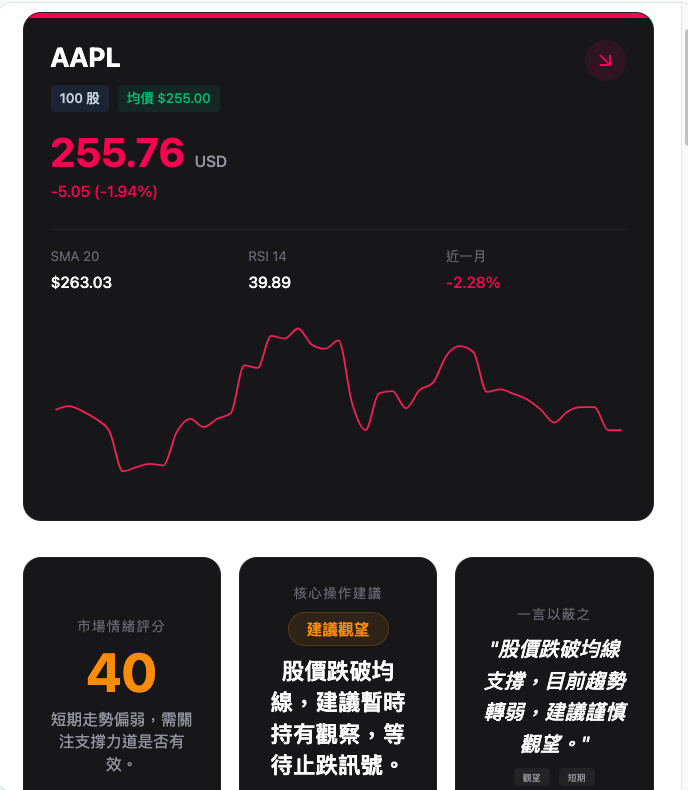
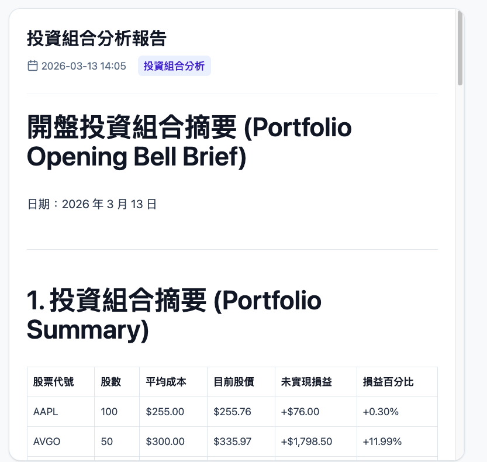
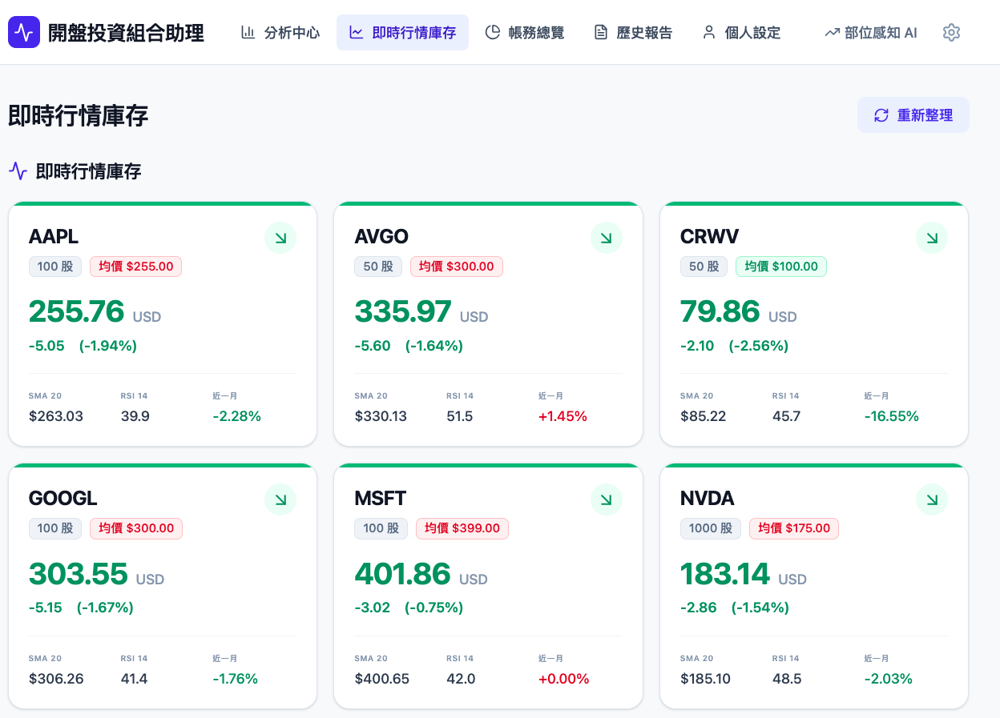
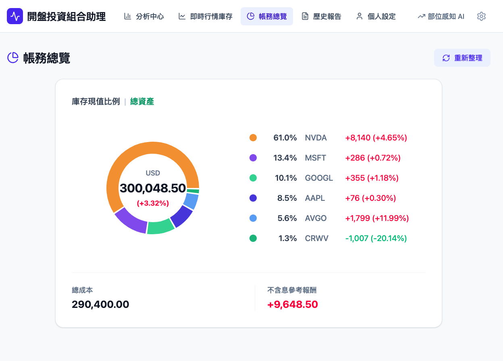

# Portfolio Opening Bell Agent

[English](./README.md) | [繁體中文](./README.zh-TW.md)

**Live demo:** [https://portfolio-opening-bell-agent.onrender.com/](https://portfolio-opening-bell-agent.onrender.com/)  
*(First load may take ~30 seconds due to Render free-tier cold start.)*

A position-aware AI portfolio assistant: combine your holdings, live market data, and news to produce opening-bell briefs and decision dashboards, with trend-trading guidance and risk checks.

[](https://www.typescriptlang.org/)
[](https://reactjs.org/)
[](https://expressjs.com/)
[](https://vitejs.dev/)

> Performance, error-handling, and architecture notes: [OPTIMIZATION_SUMMARY.md](./OPTIMIZATION_SUMMARY.md)

> **Disclaimer:** This project is for educational and demonstration purposes only. It is **not investment advice**. Always do your own research before making financial decisions.

---

## Overview

- **Analysis hub**: Enter a portfolio or a single ticker to generate an opening report or a single-stock decision dashboard.
- **Position-aware AI**: Uses your holdings (shares, average cost) and live prices to compute P&L and returns, and folds that context into the analysis.
- **Decision dashboard (single stock)**: Trend state, moving averages and deviation, buy/sell/hold suggestion, risk points, support/resistance, volume, and more—shown as structured cards and charts.
- **Portfolio opening report**: AI opening summary across multiple holdings, including news and market pulse.
- **Live quotes inventory**: Real-time price, change, and comparison to average cost for each saved position.
- **Account overview**: Portfolio cost, market value, P&L, return, and allocation pie chart.
- **Saved reports**: Store single-stock or portfolio reports; view, download PDF, or export ZIP.
- **Settings**: Maintain portfolio (ticker, shares, average cost) and strategy (growth/value/balanced); optional custom Gemini API key in system settings.

### Analysis hub





### Single-stock decision dashboard



[Full single-stock decision dashboard example (PDF)](./example/20260313_single-stock_Apple.pdf)

### Portfolio opening report



[Full portfolio opening report example (Markdown)](./example/20260313_portfolio.md)

### Live quotes and account overview





---

## Run locally

**Requirements:** Node.js **>= 20** (required by `yahoo-finance2` and `@google/genai`; Vite 6 also supports 18/20/22+)

1. Install dependencies:
   ```bash
   npm install
   ```
2. Create `.env.local` with:
   ```
   VITE_GEMINI_API_KEY=<your_gemini_api_key>
   ```
3. Start the development server:
   ```bash
   npm run dev
   ```

You can also paste a custom Gemini API key in the in-app System Settings instead of using `.env.local`.

**Production-style start** (serves the built app when `NODE_ENV=production`):

```bash
npm run build
NODE_ENV=production npm start
```

`npm start` runs `tsx server.ts` (same TypeScript runner as `dev`).

---

## Architecture and data flow

### Data sources and API integration

- **Quotes and technicals**  
  The backend uses **Yahoo Finance (`yahoo-finance2`)** for live and historical data used in “stock status” analysis:
  - **Live quote**: `quote(ticker)` — price, change, volume, market cap.
  - **Daily candles**: last ~60 days for **SMA20**, **RSI(14)**, **~1-month return**, and chart series.
  - **Market context**: `/api/market-context` for NASDAQ (^IXIC) and S&P 500 (^GSPC) as market mood.

- **News**  
  Dual path via **Gemini + external news APIs**:
  - **SerpAPI**: If a Serp API key is set in System Settings, the backend searches Google News (`engine=google&tbm=nws`) for up to 3 articles per ticker, then sends them with quotes to Gemini.
  - **Yahoo Finance news**: Without a Serp key, falls back to `yahooFinance.search(ticker, { newsCount: 3 })`.

- **AI analysis (Gemini)**  
  - **Single-stock dashboard**: Prompt built from quote + SMA20/RSI/recent performance + news + market context + optional position; **structured output (`responseSchema`)** returns JSON (trend, action, risks, levels, etc.). System instructions encode strict entry rules, trend trading, and Traditional Chinese output with anti-hallucination constraints.
  - **Portfolio opening report**: Parallel quote/news fetch for holdings, then Gemini summary and suggestions.
  - API key from `VITE_GEMINI_API_KEY` or in-app custom key; model is selectable (e.g. `gemini-3-flash-preview`).

### Backend vs frontend

- **Backend (Express)**: `/api/market-data`, `/api/news`, `/api/market-context`—Yahoo and SerpAPI calls stay on the server; the client sends tickers and an optional `serpApiKey`. Requests run in parallel for better throughput.
- **Frontend**: Vite + React fetches those APIs in parallel, then calls Gemini (`geminiService.ts`) and renders dashboards, reports, storage, and PDF export. Includes caching and automatic retries.

---

## License

[MIT](./LICENSE) © 2026 poirotw66
